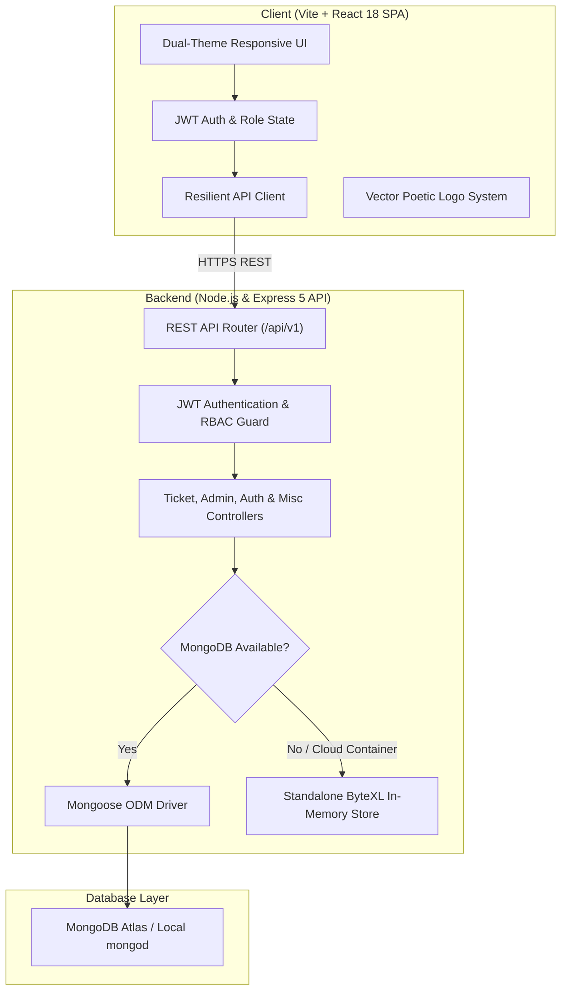
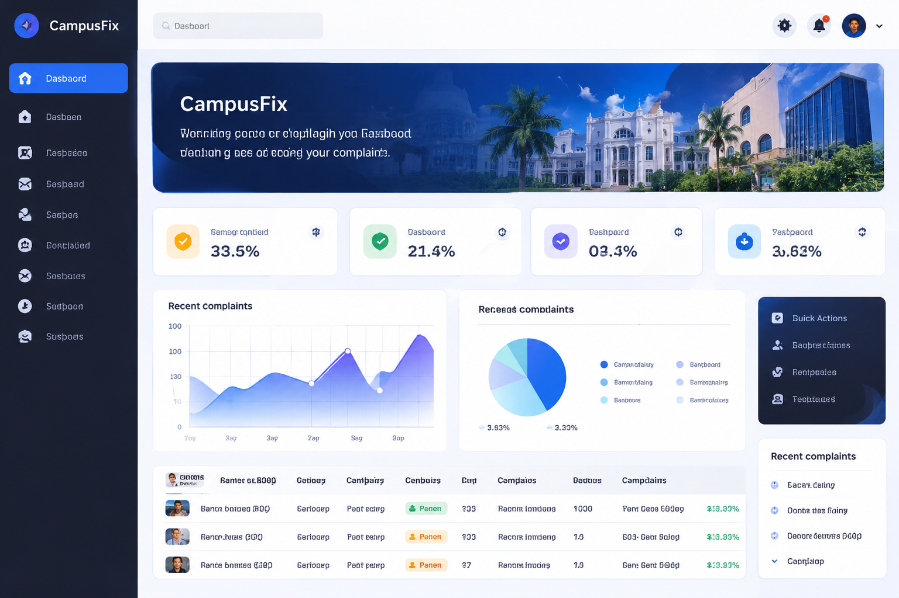
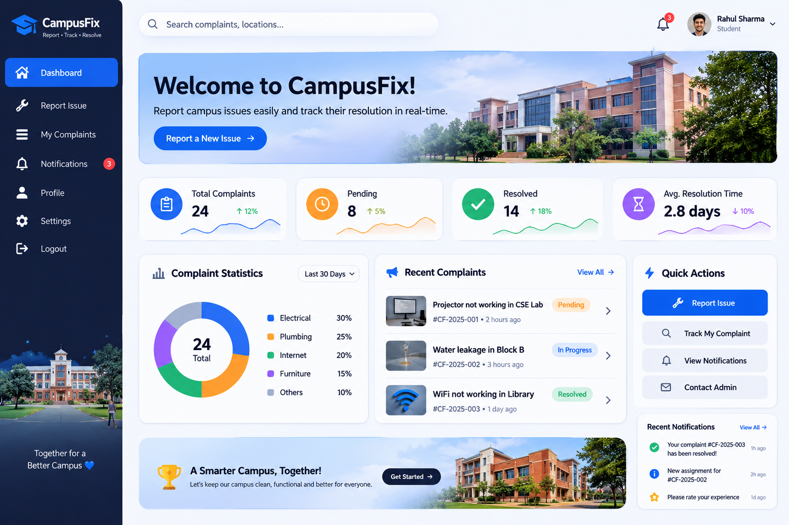
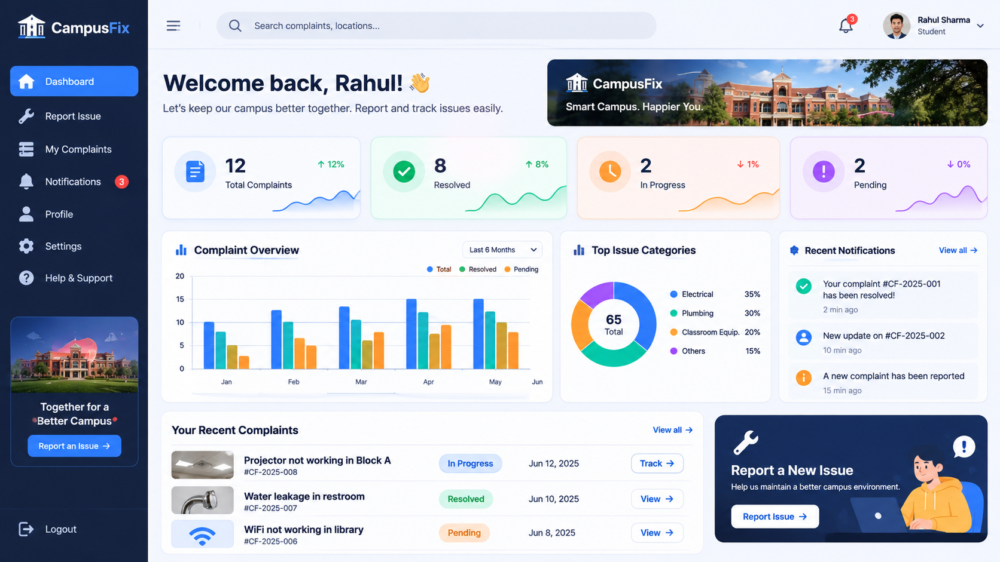

<p align="center">
  
</p>

<h1 align="center">CampusFix</h1>

<p align="center">
  <strong>Smart Campus Issue Reporting & Rapid Resolution Platform</strong>
</p>

<p align="center">
  A modern full-stack MERN platform uniting students, campus administration, and maintenance teams into a transparent, accountable, and high-velocity facility operations ecosystem.
</p>

<p align="center">
  <a href="https://github.com/aasish3187/CampusFix/stargazers"></a>
  <a href="https://github.com/aasish3187/CampusFix/network/members"></a>
  <a href="https://github.com/aasish3187/CampusFix/issues"></a>
  <a href="https://github.com/aasish3187/CampusFix/blob/main/LICENSE"></a>
  
  
</p>

---

## 📑 Table of Contents

- [The Problem & The Solution](#-the-problem--the-solution)
- [System Architecture](#-system-architecture)
- [Screenshots & UI Showroom](#-screenshots--ui-showroom)
- [Key Features](#-key-features)
- [Role-Based Workspaces](#-role-based-workspaces)
- [Tech Stack](#-tech-stack)
- [Pre-Seeded Demo Accounts](#-pre-seeded-demo-accounts)
- [REST API Reference](#-rest-api-reference)
- [Getting Started](#-getting-started)
  - [Local Development Setup](#local-development-setup)
  - [ByteXL Nimbus Cloud Deployment](#bytexl-nimbus-cloud-deployment)
- [Contributing & License](#-contributing--license)

---

## 🎯 The Problem & The Solution

| The Traditional University Challenge | The CampusFix Solution |
| :--- | :--- |
| **Paper Logs & Delayed Response:** Faulty projectors, broken ACs, or leaking pipes sit unreported in paper logbooks for days. | **Real-Time Digital Submission:** Mobile-friendly issue reporting with photo upload and instant routing to specialized staff. |
| **Duplicate Complaints:** 10 different students report the same broken elevator, flooding facility queues with redundant work. | **Proactive Duplicate Detection:** Client & server scan ongoing tickets in the same building/category in real-time as users type. |
| **Zero Transparency:** Students never know if an issue is being fixed, leading to frustration and repeat complaints. | **Verifiable Audit Timeline & Stepper:** Live state machine (`Submitted` → `Assigned` → `In Progress` → `Resolved` → `Closed`). |
| **Unverified Fixes:** Technicians mark issues fixed without confirmation. | **Student 5-Star Quality Loop:** Students review resolution quality with ratings and comments; can reopen if unresolved. |

---

## 📐 System Architecture

CampusFix is engineered with a clean separation of concerns, resilient state handling, and a dual-mode database engine:



---

## 📸 Screenshots & UI Showroom

<table width="100%">
  <tr>
    <td width="50%" align="center">
      <h3>🛡️ Facilities Administrator Overview</h3>
      <a href="./docs/screenshots/admin-dashboard.png">
        
      </a>
      <p><em>Campus-wide analytics, category distributions, interactive SLA performance charts, and live dispatch.</em></p>
    </td>
    <td width="50%" align="center">
      <h3>🎓 Student Reporting Workspace</h3>
      <a href="./docs/screenshots/student-dashboard.png">
        
      </a>
      <p><em>Personal reported issues, active queue status, resolution badges, and quick-report navigation.</em></p>
    </td>
  </tr>
  <tr>
    <td colspan="2" align="center">
      <h3>🔍 Side-by-Side Problem & Visual Evidence Inspection</h3>
      <a href="./docs/screenshots/issue-detail.png">
        
      </a>
      <p><em>Full timeline audit history, side-by-side problem description, high-resolution photo proof, technician assignment, and 5-star quality review loop.</em></p>
    </td>
  </tr>
</table>

---

## 🌟 Key Features

### 1. Intelligent Brand Identity
- **Poetic Symbolism:**
  - **Letter `a` as a Magnifying Glass:** Represents the student & faculty discovery phase — actively searching and detecting campus faults.
  - **Letter `x` as Crossed Maintenance Tools:** An open-end wrench crossing a precision tool representing swift physical repairs.
  - **Letter `i` with Resolution Spark (`✦`):** Signifies certified completion.
  - **Architectural Collegiate Crest:** Classical university pediment and pillars integrated with a golden maintenance wrench, cyan inspection lens, and emerald apex star.
- **Dual-Mode Theming:** Adaptive SVG rendering for dark workspace sidebars and crisp light landing headers.

### 2. Proactive Duplicate Complaint Scanning
- As a student types the complaint title or selects a building and category, CampusFix queries `/api/v1/tickets/check-duplicates`.
- If an existing complaint exists in the same room/wing, an alert banner appears with the active ticket code and status, preventing double-booking of technicians.

### 3. Verifiable State Machine & Audit Timeline
- Tickets transition strictly through standardized stages:  
  `Submitted` $\rightarrow$ `Assigned` $\rightarrow$ `In progress` $\rightarrow$ `Resolved` $\rightarrow$ `Closed` (or `Reopened`).
- Every action automatically appends an immutable entry to `Activity`:
  - Responsible user & role.
  - Timestamp.
  - Action summary and technician notes.

### 4. Technician Priority Queue & Dynamic Schedule
- Technicians log into their specialized queue (`Electrical`, `Plumbing`, `IT`, `Sanitation`).
- Sorts automatically by `{ updatedAt: -1 }` so newly assigned critical complaints instantly jump to position #1.
- Dynamic **"Today's On-Site Tasks"** card displays upcoming service visits with room codes and urgency badges.

### 5. 5-Star Feedback & Resolution Accountability
- Once a complaint is marked `Resolved`, the student reporter is prompted with an interactive 5-star rating widget and optional feedback remarks.
- If the issue persists upon technician departure, the student reporter has an instant **"Reopen Issue"** escalation button that returns the ticket to Facilities Administration.

### 6. Dual-Mode Database Engine
- **Live MongoDB Mode:** Connects to MongoDB Atlas or local `mongod` using Mongoose models (`User`, `Ticket`, `Activity`, `Feedback`, `Notification`).
- **ByteXL / Cloud Standalone Mode:** Automatically switches to an embedded in-memory database if an external database daemon is unavailable, ensuring zero downtime and 100% demo uptime in sandboxed environments.

---

## 👥 Role-Based Workspaces

| Role | Access Level | Primary Capabilities |
| :--- | :--- | :--- |
| **Student / Faculty** | Reporter | Submit complaints, upload photo evidence, monitor progress stepper, leave 5-star feedback, reopen unresolved tickets. |
| **Administrator** | Manager | Campus-wide overview, dispatch work to specialized technicians, update priorities, view monthly resolution charts, manage users. |
| **Maintenance Staff** | Technician | View assigned work orders, prioritize High/Critical emergencies, log resolution notes, advance tickets from Assigned to Resolved. |

---

## 🛠️ Tech Stack

### Frontend Client
- **Core Framework:** React 18 (SPA)
- **Build Tool:** Vite 8.3
- **Styling:** Modular CSS3 with CSS Variables, responsive grid layouts, and micro-interaction animations.
- **Typography:** `Outfit` (Headings & Wordmarks) + `DM Sans` (Interface text).
- **Icons & Graphics:** 100% Custom Inline SVGs & Interactive Data Charts (Zero heavyweight chart library dependencies).

### Backend API
- **Runtime:** Node.js (v18+)
- **Web Framework:** Express 5
- **Authentication:** JSON Web Tokens (JWT) + bcryptjs password hashing.
- **Database ODM:** Mongoose 9.x
- **Uploads:** Multi-part form-data support with Base64 / SVG data URI generators.
- **CORS:** Multi-origin whitelist configured for local, Vite preview, and cloud proxy hosts.

### Database & Cloud
- **Primary Database:** MongoDB 7.x / MongoDB Atlas.
- **Fallback Engine:** Embedded In-Memory Store for instant single-container deployment.
- **Cloud Support:** ByteXL Nimbus, Render, Railway, Vercel, Docker.

---

## 🔑 Pre-Seeded Demo Accounts

All seeded accounts share the unified password: **`CampusFix@123`**

| Role | Name | Email | Department / Specialization |
| :--- | :--- | :--- | :--- |
| **Administrator** | Riya Sharma | `riya@campusfix.edu` | Facilities Operations Head |
| **Student** | Aasish Student | `aasish@campusfix.edu` | Computer Science & Engineering |
| **Faculty** | Dr. Ramesh V | `ramesh@campusfix.edu` | Electronics & Communication |
| **Maintenance Staff** | Arjun Kumar | `arjun@campusfix.edu` | Electrical & Equipment Specialist |
| **Maintenance Staff** | Nikhil Rao | `nikhil@campusfix.edu` | Plumbing & Water Systems Specialist |
| **Maintenance Staff** | Anita Devi | `anita@campusfix.edu` | Sanitation & Housekeeping Specialist |
| **Maintenance Staff** | Priya Sharma | `priya@campusfix.edu` | Network & IT Infrastructure Specialist |

> *Tip: The sign-in page features **1-Click Fill Chips** for instant switching between roles during demonstrations.*

---

## 📡 REST API Reference

All API routes are prefixed with `/api/v1`.

### 🔐 Authentication (`/auth`)
| Method | Endpoint | Description | Access |
| :--- | :--- | :--- | :--- |
| `POST` | `/auth/register` | Register new student or faculty account | Public |
| `POST` | `/auth/login` | Authenticate user with role validation | Public |
| `GET` | `/auth/me` | Fetch currently authenticated user session | Bearer Token |
| `PATCH` | `/auth/profile` | Update profile information | Bearer Token |

### 🎫 Tickets & Complaints (`/tickets`)
| Method | Endpoint | Description | Access |
| :--- | :--- | :--- | :--- |
| `GET` | `/tickets` | List tickets (filtered by role, tab, category, priority, query) | Authenticated |
| `GET` | `/tickets/:id` | Get single ticket with resolution notes and feedback | Authenticated |
| `POST` | `/tickets` | Submit a new complaint with title, room, category, and images | Student / Admin |
| `PATCH` | `/tickets/:id` | Update status, assign technician, set priority, or add note | Staff / Admin |
| `POST` | `/tickets/:id/reopen` | Reopen an issue with escalation notes | Student Reporter |
| `POST` | `/tickets/:id/feedback` | Submit 1–5 star rating and remarks | Student Reporter |
| `GET` | `/tickets/:id/activities` | Retrieve chronological audit history | Authenticated |
| `GET` | `/tickets/check-duplicates` | Query active complaints by building & category | Authenticated |
| `GET` | `/tickets/staff-list` | Retrieve list of active technicians | Admin |

### 📊 Administration (`/admin`)
| Method | Endpoint | Description | Access |
| :--- | :--- | :--- | :--- |
| `GET` | `/admin/analytics` | Retrieve campus-wide SLA metrics and category stats | Admin |
| `GET` | `/admin/users` | List all registered campus accounts | Admin |
| `POST` | `/admin/users` | Create technician or staff profile | Admin |
| `PATCH` | `/admin/users/:id/status` | Enable or disable user account | Admin |

### 🔔 Notifications (`/notifications`)
| Method | Endpoint | Description | Access |
| :--- | :--- | :--- | :--- |
| `GET` | `/notifications` | Retrieve unread and historical notifications | Authenticated |
| `PATCH` | `/notifications/:id/read` | Mark individual notification as read | Authenticated |
| `PATCH` | `/notifications/mark-all-read` | Mark all user notifications as read | Authenticated |

---

## 🚀 Getting Started

### Local Development Setup

#### 1. Clone the repository
```bash
git clone https://github.com/aasish3187/CampusFix.git
cd CampusFix
```

#### 2. Start the Backend API
```bash
cd server
npm install

# (Optional) Seed the database with demo accounts, historical logs, and on-site photos:
npm run seed

# Start the API server on port 5000:
npm run dev
```

#### 3. Start the Frontend Application
```bash
# In a second terminal window:
cd client
npm install

# Start the Vite development server:
npm run dev
```

Visit **`http://localhost:5173`** in your browser.

---

### ByteXL Nimbus Cloud Deployment

CampusFix is pre-configured for **ByteXL Nimbus** with `allowedHosts: true` and an automatic in-memory fallback engine:

1. **In ByteXL Nimbus:** Open your workspace terminal.
2. **Start Backend:**
   ```bash
   cd server
   npm install
   npm run dev
   ```
   *(Starts on port 5000 in ByteXL Native Mode).*
3. **Start Frontend:**
   ```bash
   cd ../client
   npm install
   npm run dev
   ```
4. **View App:** Click the **Ports** tab in Nimbus and open port **`5173`** (or `3000`) in the browser preview!

---

## 📄 License & Author

Distributed under the **MIT License**. See `LICENSE` for more information.

Developed with ❤️ by **[Aasish (aasish3187)](https://github.com/aasish3187)**.
